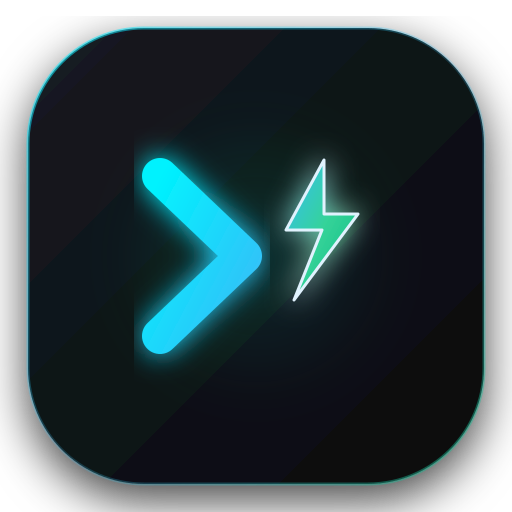

  

<h1 align="center">ShizuShell</h1>

  <strong>An elevated, modern Android terminal and shell manager powered by Shizuku.</strong> 
  Execute ADB-level shell commands, grant system permissions, and manage packages directly on-device — no PC, cable, or root required.

  
  
  
  
  
  

---

## ⚡ Overview

**ShizuShell** bridges the gap between everyday Android power users and high-level command-line control. By leveraging the **Shizuku** framework, ShizuShell executes commands with full `adb` shell privileges directly on your smartphone or tablet. 

Whether you need to debloat carrier apps, grant `WRITE_SECURE_SETTINGS` to customization tools, inspect deep system diagnostics, or run custom automated shell scripts, ShizuShell gives you a sleek, intuitive, and safe environment to do it in seconds.

---

## ✨ Key Features

### 🖥️ Elevated Terminal & Multi-Session Engine
* **Elevated ADB Execution:** Run shell commands with native ADB (UID 2000) or root privileges on-device.
* **Multi-Tab Sessions:** Create, rename, switch between, and manage multiple isolated shell sessions simultaneously.
* **Dual Display Modes:** Switch between modern interactive chat bubbles and a classic continuous console stream.
* **Rich Output Metrics:** View command exit codes (`0` for success, non-zero error codes), timestamps, and precise execution duration down to the millisecond.
* **Quick Command Chips:** Instant 1-tap buttons for frequently used commands (`dumpsys battery`, `pm list packages -3`, `getprop`, `df -h`, `id`, `settings list global`).
* **Terminal Customization:** Choose terminal font size, output line buffers, and enjoy crisp monospace rendering with bundled **JetBrains Mono**.

### 🛡️ One-Tap Permission Grant Manager
* **Grant Secure Permissions Without a PC:** Never plug into a computer just to run `adb shell pm grant` again!
* **Popular Developer Presets:** 1-tap permission granting for:
  * `android.permission.WRITE_SECURE_SETTINGS` (System tweaks, automation apps)
  * `android.permission.READ_LOGS` (Logcat analyzers)
  * `android.permission.DUMP` (Detailed system status utilities)
  * `android.permission.PACKAGE_USAGE_STATS` (Usage trackers)
  * `android.permission.SYSTEM_ALERT_WINDOW` (Floating overlays)
  * `android.permission.CHANGE_CONFIGURATION` (Locale and font changers)
* **Custom Permissions:** Type any custom permission string and choose your target package with built-in app picker.

### 📦 Comprehensive Package Manager
* **Explore Packages:** Filter instantly between **User (Third-Party)**, **System**, and **Disabled** packages.
* **Package Actions with Elevated Control:**
  * 🟢 **Enable / 🔴 Disable:** Freeze or unfreeze unwanted pre-installed apps and carrier bloatware.
  * ⏹️ **Force Stop:** Immediately kill running background tasks for any app.
  * 🧹 **Clear Data & Cache:** Free up storage space or reset problematic apps.
  * 🗑️ **Uninstall:** Remove packages directly from the UI.
* **Deep Details:** Inspect Package Name, APK install path, Version, UID, and Installer Source.

### 📑 Smart Command Snippets & Parametric Templates
* **Curated Snippet Library:** Preloaded with essential snippets across categories (*Package Manager, Diagnostics, Settings, Activity Manager, Logs, Media*).
* **Dynamic Variable Prompts:** Placeholders like `{package}`, `{permission}`, `{service}`, `{namespace}`, `{key}`, and `{value}` trigger interactive popups for effortless execution.
* **Custom Snippets:** Build, edit, tag, search, and bookmark your personal shell scripts.

### 🕒 Searchable History & Pinned Commands
* **Complete Execution Log:** Every command execution is recorded in a local SQLite database powered by Room.
* **Filter & Search:** Filter history by exit code (Success vs. Errors) and search through past commands.
* **1-Tap Rerun & Pin:** Rerun any past command with a single tap or pin your most critical commands to the top.

### 🚨 Built-in Safety Safeguards
* **Dangerous Command Detection:** Intelligent regex filters detect destructive operations (such as `rm -rf`, `format`, `mkfs`, `dd`, `reboot bootloader`) and prompt an explicit confirmation dialog before executing.
* **Session Safety:** Clear terminal history or wipe saved logs anytime with confirmation prompts.

### 🎨 Modern Material Design 3 Experience
* **Adaptive Multi-Form-Factor Layout:** Optimized for phones (clean bottom navigation bar) and tablets/foldables (responsive navigation rail).
* **Theme Customization:** Support for System Default, Light Mode, Dark Slate, and pure AMOLED Black.
* **Edge-to-Edge:** Full immersive Android edge-to-edge layout with precise keyboard (IME) and system bar inset management.

---

## 📥 Download & Installation

You can download the ready-to-install APK directly from the **[Releases](../../releases)** section:

1. Go to the **[Releases](../../releases)** page.
2. Download the latest `ShizuShell.apk`.
3. Open the downloaded file and install it on your Android device (Android 8.0+ recommended).

---

## 🚀 Quick Start Guide

1. **Install Shizuku:**
   * Download and set up [Shizuku](https://shizuku.rikka.app/) on your device.
   * Start the Shizuku service via **Wireless Debugging** (Android 11+) or via **ADB / Root**.
2. **Launch ShizuShell:**
   * Open ShizuShell. The app will detect the Shizuku service status.
   * Tap **Request Permission** when prompted and approve ShizuShell in the Shizuku dialog.
3. **Start Executing:**
   * Type any shell command or tap a Quick Chip (e.g., `dumpsys battery`).
   * Explore the **Packages**, **Perms**, and **Snippets** tabs to manage your device!

---

## 🛠️ Tech Stack & Architecture

* **UI Framework:** [Jetpack Compose](https://developer.android.com/jetpack/compose) with [Material Design 3](https://m3.material.io/)
* **Privileged Execution:** [Shizuku API](https://github.com/RikkaApps/Shizuku-API)
* **Local Persistence:** [Android Jetpack Room](https://developer.android.com/training/data-storage/room)
* **Preferences:** [AndroidX DataStore](https://developer.android.com/topic/libraries/architecture/datastore)
* **Architecture:** MVVM (Model-View-ViewModel) with Kotlin Coroutines and StateFlow
* **Typography:** [JetBrains Mono](https://www.jetbrains.com/lp/mono/)

---

## 🤝 Contributing

Contributions, feature requests, and bug reports are warmly welcome!
1. Fork the Project.
2. Create your Feature Branch (`git checkout -b feature/AmazingFeature`).
3. Commit your Changes (`git commit -m 'Add some AmazingFeature'`).
4. Push to the Branch (`git push origin feature/AmazingFeature`).
5. Open a Pull Request.

---

## 📄 License

This project is open source and available under the [Apache License 2.0](LICENSE).
